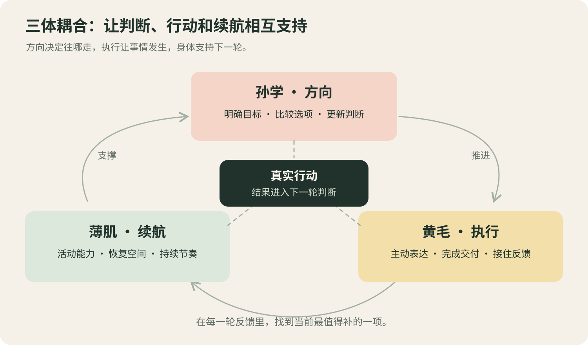
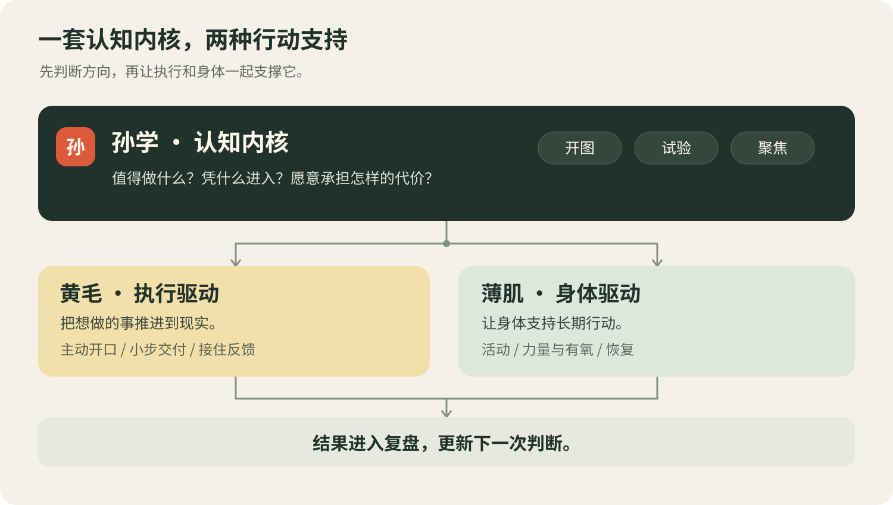
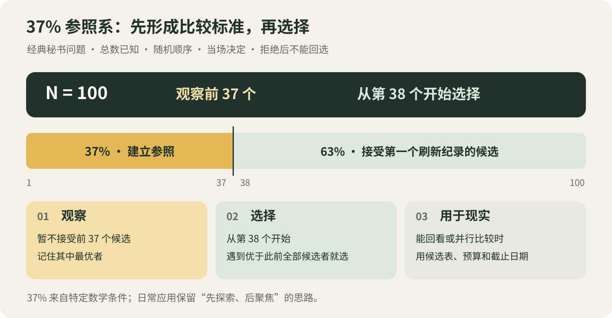
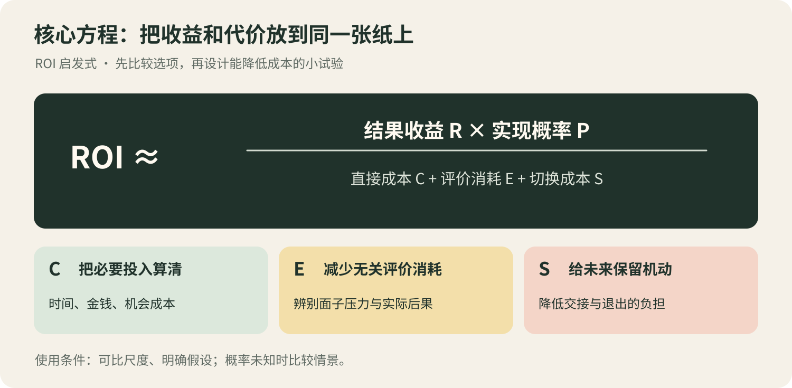
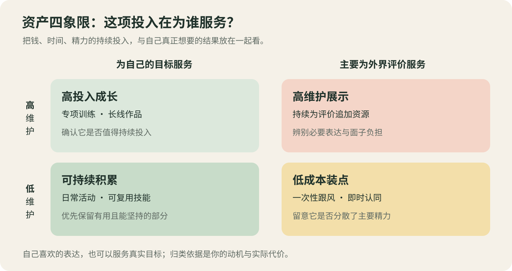
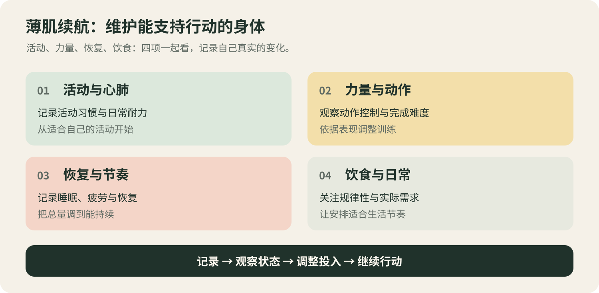
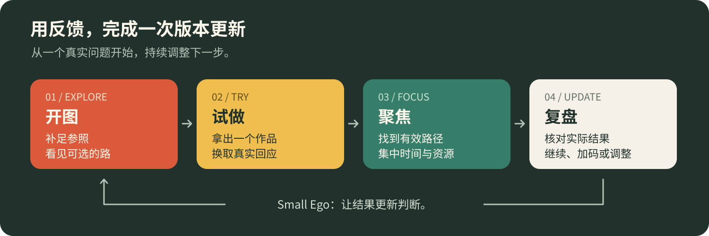
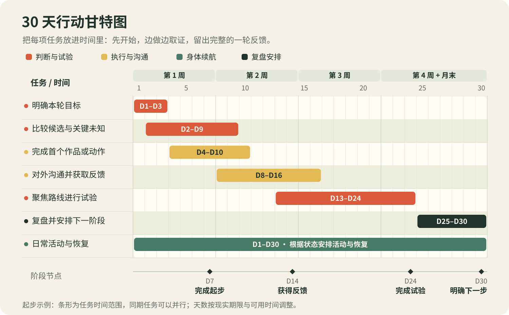

**一个帮助你做选择、推进行动的 Agent Skill。** 安装后，AI 会根据你的目标和实际条件，分析可选方案、说明理由，并给出下一步。

| 模块 | 用来解决什么 |
|---|---|
| **孙学** | 人生和事业选择：要不要转行、先学什么、哪个项目值得做。 |
| **黄毛** | 行动和沟通：如何开始、怎么回复、怎样邀约或拒绝。 |
| **薄肌** | 身体和日常安排：训练、饮食、疲劳与恢复。 |

> 非官方的网络梗整理与改写，与孙宇晨本人及其关联机构无关，未获其授权或背书。“孙哥式”表达是风格化写法，不代表本人言论。

[安装](#install) · [使用示例](#example) · [核心模型](#models) · [30 天实践](#practice) · [场景与文件](#files) · [来源](#credits)

<a id="install"></a>
<a id="start"></a>

## 安装

使用支持 `SKILL.md` 和文件读取的 Agent，按客户端提供的入口安装：

- **从 GitHub 安装**：客户端支持仓库安装时，在技能安装入口填入本仓库地址。
- **本地导入**：点击 GitHub 的 **Code → Download ZIP** 并解压，导入包含 `SKILL.md` 的完整文件夹。手动放入技能目录时，将文件夹命名为 `sun-huang-bo`。
- **项目加载**：用支持项目指令的 Agent 打开仓库，按 [`AGENTS.md`](AGENTS.md) 读取 [`SKILL.md`](SKILL.md)。

启用 **sun-huang-bo** 后，直接说明你遇到的问题。日常使用无需安装 Python。

<a id="example"></a>

## 使用示例

**你问：**

> 工作第二年，存款不多，身边同事都在贷款买车。我要不要也买？

**示例回答（孙学）：**

**先别把自由抵押给月供。** 车本身没问题，问题是为了面子锁死现金流。先算三笔账：

1. **持有成本**：月供、保险、停车、油费加起来，占月收入多少？
2. **真实用途**：每周实际开几次？是通勤、接送家人，还是周末和面子？
3. **替代方案**：打车、租车、二手车，各算一遍全年花费。

用途撑得起就买；撑不起，这笔钱先投到能涨收入的技能上。**承诺越轻，机会来的时候你越跑得动。**

**你问：**

> 做了个小作品想发朋友圈，又怕熟人说我在装。

**示例回答（黄毛）：**

**想发就发。朋友圈是你的，又不是他们的。**

> 第一版，做着玩的。

有人说装？随便说去，你忙着做第二版，没空解释。真有人挑出毛病，顺手改了，就当白捡一条反馈。

实际回答会结合你的经历、目标和时间。聊天回复、项目比较、训练安排也可以单独提问。

---

<a id="models"></a>

## 核心模型

[三体耦合](#coupling) · [37% 参照系](#rule37) · [核心方程](#equations) · [资产四象限](#quadrants) · [身体续航](#endurance)

<a id="coupling"></a>

### 三体耦合：定位卡住的那一环



```text
方向判断 × 身体续航 × 持续执行
```

这三个因素相互影响。先问：方向明确吗？精力够用吗？行动能持续吗？

找到当前最影响进展的一项：方向不清就比较选项，迟迟没行动就完成一项小任务，疲劳拖慢进度就调整负荷与恢复。八种组合与自评方式见[三体耦合模型](docs/05-三体耦合模型.md)。

<a id="system"></a>

<details>
<summary>查看三个模块的分工图</summary>



</details>

<a id="rule37"></a>

### 37% 参照系：先比较，再选择



经典模型有 100 个候选时，先观察前 37 个，记住其中最优者；从第 38 个开始，选择第一个超过这一标准的候选。如果始终没有更优者，又必须选一个，就选最后一个。

选工作、课程或项目时，可以先列候选、建立比较标准，再设定探索预算和决定日期。能够回头比较的选项，就按这些标准一起评估。具体用法见[全图插眼与 37% 参照系](docs/06-全图插眼与37%参照系.md)。

<details>
<summary>37% 成立的数学条件</summary>

经典秘书问题要求：候选总数已知、顺序随机、优劣可排序且无并列；每次当场决定，拒绝后不能返回；只选一次，目标是选中全体最优。

大样本下，最优观察比例与选中最优者的概率都趋近 `1/e ≈ 36.8%`。[数学出处](https://www.math.ucla.edu/~tom/Stopping/sr2.pdf)

</details>

<a id="equations"></a>

### 核心方程：拆开收益与行动成本



```text
ROI 启发式 = (R × P) / (C + E + S)
```

| 符号 | 需要填清楚的内容 |
|---|---|
| **R** | 希望获得的结果：收入、能力、自由、关系或体验。 |
| **P** | 对实现机会的判断，以及支持它的事实。 |
| **C** | 从现在开始所需的时间、钱、注意力和机会成本。 |
| **E** | 无关评价带来的犹豫、解释和面子消耗。 |
| **S** | 改变路线时要承担的学习、交接和退出成本。 |

采用可比尺度才能比较方案。概率未知时，用顺利、普通、失败几种情景展开；重要选择另列可承受损失和回报周期。[孙学中的具体用法](docs/02-孙学.md#cognition)

决定以后，进一步拆开为什么还没动手：

```text
C(action) = C(task) + C(face) + C(permission)
行动成本  = 任务投入 + 面子压力 + 许可相关成本
```

任务投入过大，就缩小第一次交付。怕丢脸，就准备一次清楚的表达。需要别人参与，就分清习惯性等待认可与真实同意、协作权限、已有承诺。场景练习见[黄毛](docs/04-黄毛.md)。

<a id="quadrants"></a>

### 资产四象限：辨认持续投入的去向



横向看投入主要服务自己的目标，还是外界评价；纵向看它需要多少持续维护。把经常花钱、时间和精力的事情放进去，决定保留、减少投入或停止。

例如，一项长期训练维护成本高，但支持自己的目标，就值得保留；一个很少使用、只因别人都订了而续费的工具，就值得重新考虑。

<a id="endurance"></a>

### 身体续航：把计划放回日常生活



记录活动和动作表现，也记录疲劳与恢复。需要从中读出的信息，是现在的安排能否持续、下一次该增加什么或减少什么。[薄肌文档](docs/03-薄肌.md)提供具体观察方式。

身体成分有一些可以直接计算的量：

```text
脂肪质量 = 体重 × 体脂比例
去脂体重 = 体重 × (1 − 体脂比例)
情景体重 = 去脂体重 ÷ (1 − 目标体脂比例) 〔假设去脂体重不变〕
```

去脂体重包含肌肉、骨骼、器官和水分。算术用于比较给定假设下的情景，目标由自己提供。示例见[肌肉资产负债表](docs/07-肌肉资产负债表.md)。

---

<a id="practice"></a>
<a id="loop"></a>

## 30 天实践与记录

选一件想推进的事，依次调查、尝试、收集反馈，再决定下一步。



下面用甘特图安排一个月的任务。条形表示起止时间，重叠的任务可以并行；按自己的可用时间调整。



每次只需记下：**做了什么、得到什么反馈、下一步怎么做。**

**行动手册**：[每日循环](playbook/每日循环.md) · [30 天启动](playbook/30天启动.md)

**记录模板**：[个人总纲](templates/personal-profile.md) · [每日记录](templates/daily.md) · [决策记录](templates/decision-37.md) · [身体记录](templates/health-data.md) · [社交练习](templates/social-practice.md) · [周复盘](templates/weekly-review.md)

---

<a id="files"></a>
<a id="reading"></a>

## 场景与仓库文件

<a id="scenes"></a>
<a id="use-cases"></a>

| 需要做什么 | 场景入口 |
|---|---|
| 比较人生与事业选择 | [人生决策](prompts/10-孙学人生决策.md) · [三策推演](prompts/02-三策推演.md) · [全图插眼](prompts/05-全图插眼100专业.md) |
| 学习、做作品、传播内容 | [学习与创造](prompts/11-孙学学习与创造.md) · [增长传播与表达](prompts/09-孙学增长传播与表达.md) |
| 开始行动、处理沟通 | [噪音隔离](prompts/06-黄毛护甲-噪音隔离.md) · [社交回复](prompts/07-黄毛社交回复.md) · [邀约与边界](prompts/08-黄毛邀约与边界.md) |
| 整理状态、安排训练与复盘 | [现状诊断](prompts/01-现状诊断.md) · [饮食卡路里识别](prompts/03-饮食卡路里识别.md) · [训练渐进超载](prompts/04-训练渐进超载.md) · [周复盘](prompts/12-Small-Ego周复盘.md) |

`SKILL.md` 负责把问题分配到相关材料；`docs` 放理论正文；`prompts` 放具体场景；`templates` 放可填写的记录；`playbook` 放连续使用的方法。

孙学内容合在 `02-孙学.md`，黄毛内容合在 `04-黄毛.md`，各自在文档内部按主题分节。

<a id="structure"></a>

```text
sun-huang-bo/
├── README.md                首页与使用说明
├── SKILL.md                 Agent 技能入口
├── AGENTS.md                仓库协作说明
├── SOURCES.md               整合来源与署名
├── docs/                    9 篇主题文档
│   ├── 01-总纲.md
│   ├── 02-孙学.md
│   ├── 03-薄肌.md
│   ├── 04-黄毛.md
│   ├── 05-三体耦合模型.md
│   ├── 06-全图插眼与37%参照系.md
│   ├── 07-肌肉资产负债表.md
│   ├── 08-Small-Ego与版本更新.md
│   └── 09-边界-争议与反面.md
├── prompts/                 12 个场景提示词
│   ├── 01-现状诊断.md
│   ├── 02-三策推演.md
│   ├── 03-饮食卡路里识别.md
│   ├── 04-训练渐进超载.md
│   ├── 05-全图插眼100专业.md
│   ├── 06-黄毛护甲-噪音隔离.md
│   ├── 07-黄毛社交回复.md
│   ├── 08-黄毛邀约与边界.md
│   ├── 09-孙学增长传播与表达.md
│   ├── 10-孙学人生决策.md
│   ├── 11-孙学学习与创造.md
│   └── 12-Small-Ego周复盘.md
├── templates/               6 个记录模板
├── playbook/                每日循环与 30 天使用方法
├── assets/                  9 张本地 SVG 配图
│   ├── cover.svg
│   ├── system-map.svg
│   ├── coupling-flywheel.svg
│   ├── rule37.svg
│   ├── core-equations.svg
│   ├── asset-quadrants.svg
│   ├── body-foundation.svg
│   ├── action-loop.svg
│   └── roadmap.svg
├── scripts/sunxue.py        可选计算工具
├── agents/openai.yaml       OpenAI/Codex 展示信息
├── licenses/                来源许可
└── LICENSE                  MIT 许可文本
```

个人记录放在自己的工作目录，按需要取用模板。

截至 2026-10-13，平台首页显示内测，可提交入驻意向。其技能上传说明要求 ZIP 根目录包含 `SKILL.md`，发布时按要求填写图标、版本等信息。

</details>

<details>
<summary>agents/openai.yaml 的用途</summary>

为 OpenAI/Codex 提供名称、简介和默认调用语句。技能内容从 `SKILL.md` 加载。

</details>

<a id="tools"></a>

<details>
<summary><b>需要辅助计算时：Python 3.8+，零第三方依赖</b></summary>

在仓库目录执行：

```shell
python scripts/sunxue.py --help
python scripts/sunxue.py diag
python scripts/sunxue.py 37 --n 100 --classical
python scripts/sunxue.py today
```

`diag` 显示自评说明，再按说明传入评分；`roi` 比较给定成本；`body` 计算身体成分情景；`37` 演示经典秘书问题；`today` 输出记录模板，使用 `--out` 可指定保存位置。参数说明见 [SKILL.md](SKILL.md#可选计算)。

</details>

---

<a id="credits"></a>

## 来源与致谢

感谢以下四个仓库的作者与整理者。本系统的内容来自这些资料的整合与改写：

- **[chinggg / sunxue-boji-huangmao](https://github.com/chinggg/sunxue-boji-huangmao)**：提供孙学、黄毛、薄肌的基本关系，以及方程、耦合、37% 参照系和配套工具。
- **[0xquqi / sun-skill](https://github.com/0xquqi/sun-skill)**：补充模型选择、时机、聚焦、增长与表达。
- **[wousp112 / justin-sun-alan-shao-ai-notes](https://github.com/wousp112/justin-sun-alan-shao-ai-notes)**：补充 AI 协作、个人选择、探索、学习创造与 Small Ego。
- **[cugfzx / huangmao-skill](https://github.com/cugfzx/huangmao-skill)**：补充社交情境、表达方式和行动练习。

相关材料入口：

| 材料 | 阅读位置 |
|---|---|
| 孙宇晨与邵艾伦的对谈 | [原视频](https://www.youtube.com/watch?v=0Z-vhBvBmUY) · [深潮 TechFlow 笔记](https://www.techflowpost.com/article/34433) |
| 孙学、黄毛、薄肌的公开论述 | [孙宇晨在币安广场的文章](https://www.binance.com/en-KZ/square/post/365096571912087) |
| 薄肌理论与俱乐部规则 | [主模型中的整理](https://github.com/chinggg/sunxue-boji-huangmao/blob/main/docs/03-薄肌-身体杠杆.md) |
| 《财富自由革命之路》相关提炼 | [sun-skill 来源说明](https://github.com/0xquqi/sun-skill) |
| 37% 规则的数学条件 | [Ferguson 经典秘书问题讲义](https://www.math.ucla.edu/~tom/Stopping/sr2.pdf) |
| 一般身体活动建议 | [WHO 身体活动资料](https://www.who.int/news-room/fact-sheets/detail/physical-activity) |

具体整合去向与改写说明见 [SOURCES.md](SOURCES.md)。9 张配图为本仓库绘制。发布与转载时请保留 [MIT 许可](LICENSE)、访谈笔记相关改写的 [CC BY 4.0 署名说明](licenses/alan-notes-LICENSE.txt)及对应来源。
